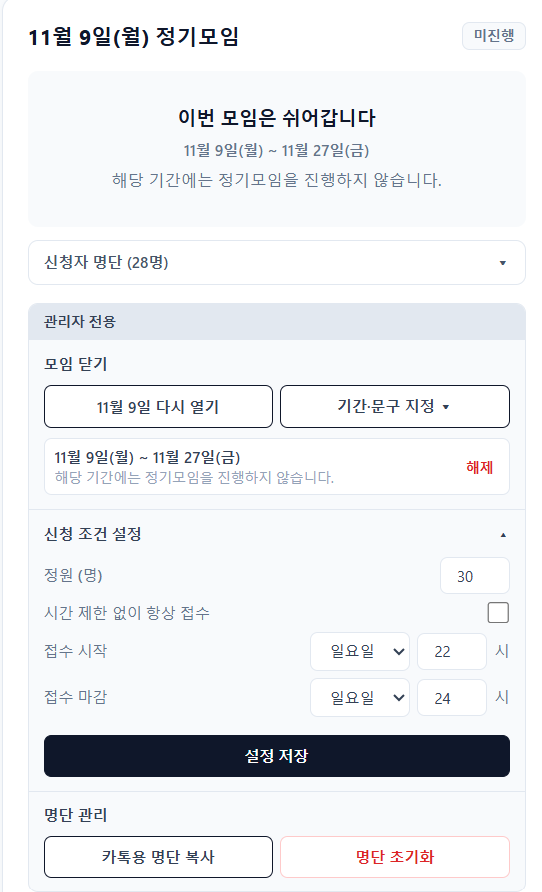
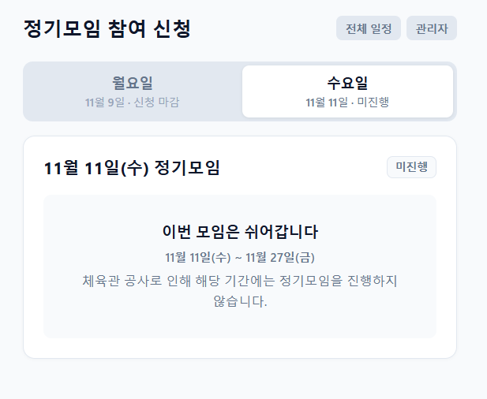

## 동아리 정기모임 신청 사이트

- **기간**: 2026년 1학기 ~ 현재
- **상태**: 진행 중 (동아리에서 실제로 사용하며 기능을 개선하고 있음)
- **형태**: 개인 프로젝트
- **사용 기술**: HTML, CSS, JavaScript, Firebase Realtime Database, Netlify

## 목적

제가 소속되어 있는 동아리는 일주일에 두 번 정기모임을 하는데, 부원 150~200명 가운데 30명만 선착순으로 받습니다. 그동안은 카카오톡 투표로 신청을 받았고, 이 방식에는 세 가지 문제가 있었습니다.

1. **투표를 여는 사람의 부담**: 매주 일요일 22시 정각에 투표를 열어야 해서, 동아리 회장이 5분 전부터 알람을 맞춰 두고 기다렸다가 올려야 했습니다.
2. **정원 초과**: 카카오톡 투표에는 정해진 인원이 차면 자동으로 마감하는 기능이 없어, 30명을 넘게 받는 경우가 생겼습니다. 동아리 장소가 협소해서 인원이 초과되면 모임 진행이 매우 곤란해집니다.
3. **명단 공유**: 정기모임 전에 임원진끼리 명단을 주고받는 과정도 더 효율적으로 바꾸고 싶었습니다.

이 문제를 계속 고민하던 중, 경쟁이 과열되어 30명 정원에 약 10명 이상이 초과 신청된 일이 있었고, 그때 직접 신청 사이트를 만들기로 했습니다.

## 역할

개인 프로젝트로, 문제 정의부터 운영까지 직접 진행했고 코드 구현에는 AI 도구의 도움을 받았습니다.

- **직접 한 일**: 카카오톡 투표 방식의 문제 파악, 필요한 기능 기획과 설계, Firebase 전환 결정, 직접 실행하며 동작 확인, 임원진에게 링크를 보내 테스트 요청, Netlify 배포, 동아리 실사용 운영과 개선 방향 결정
- **AI 도구의 도움을 받은 일**: 코드 작성, 오류 원인 분석

## 진행 과정

1. **첫 버전 (Google Apps Script)**: 처음에는 신청 기능만 필요하다고 생각해서, Google Apps Script와 스프레드시트를 연결해 신청자 명단이 시트에 기록되는 방식으로 만들었습니다.
2. **테스트와 실사용 시작**: 임원진에게 링크를 보내 테스트를 부탁해 동작을 확인한 뒤, 동아리 정기모임 신청에 실제로 사용하기 시작했습니다.
3. **Firebase로 전환**: 사용하면서 편의 기능을 추가하려고 하자 스프레드시트 방식으로는 한계가 보여, 데이터 저장을 Firebase Realtime Database로 바꿨습니다.
4. **기능 추가**: 지금도 필요한 기능을 하나씩 추가하며 사용하고 있습니다. 대표적인 개선은 다음과 같습니다.
   - **관리자 설정 화면**: 처음에는 정원 같은 설정을 바꾸려면 제가 직접 코드를 수정해야 해서 저만 바꿀 수 있었습니다. 임원진도 직접 설정을 바꿀 수 있도록, 사이트 안의 관리자 모드에서 정원과 신청 시간을 바로 설정하는 기능을 만들었습니다.
        

<strong>이미지 보기</strong>

   - **모임 날짜 자동 표시**: 처음에는 신청 카드에 "월요일", "수요일"처럼 요일만 표시했지만, 다가오는 모임 날짜를 계산해 "0월 00일(월) 정기모임"처럼 날짜까지 보이도록 바꿨습니다.
   - **신청 명단 공개**: 처음에는 신청 명단을 임원진만 확인할 수 있었는데, 신청이 되었는지 물어보는 부원들이 있어 부원들도 직접 명단을 보고 신청 여부를 확인할 수 있도록 바꿨습니다.
   - **일정 달력**: 부원들이 정기모임 기간과 행사 일정을 한눈에 확인할 수 있도록 달력을 추가했습니다.
   - **모임 닫기**: 장소를 불가피하게 사용할 수 없거나 정기모임 활동을 쉬는 기간에는 공지를 해도 신청하는 부원들이 있었습니다. 그래서 관리자가 쉬는 사유와 기간을 정해 신청을 닫으면, 그 기간에는 신청 양식 대신 "이번 모임은 쉬어갑니다" 같은 안내가 보이도록 하는 기능을 추가했습니다.
        

<strong>이미지 보기</strong>

### 기술 선택 이유

처음에는 신청만 받으면 되었기 때문에 스프레드시트와 바로 연결되고 사용이 쉬운 Google Apps Script를 선택했습니다. 이후 관리자 설정, 대기 접수, 실시간 명단 같은 기능을 넣으려다 한계를 느껴, 여러 사람이 동시에 신청해도 명단이 바로 반영되는 Firebase Realtime Database로 바꿨습니다.

### 주요 기능

- 월요일·수요일 정기모임별 신청 카드
- 정원 선착순 신청과 정원 초과 시 대기 접수
- 확정자가 취소하면 대기자가 자동으로 확정으로 올라가는 기능
- 신청 여부를 바로 확인할 수 있는 실시간 신청 명단과 본인 신청 취소 기능
- 하반기 모임·휴무 일정 달력
- 관리자 모드: 정원·신청 시간 설정, 명단 초기화, 카카오톡 공유용 명단 복사

## 결과물

- 운영 중인 사이트: <https://highcock-meeting.netlify.app/>
- 소스 코드: <https://github.com/snsbsjs/club-meeting-signup>

## 배운 점

- 원래 없던 도구를 동아리와 임원진의 편의를 위해 직접 만들었고, 그것이 실제로 유용하게 쓰이는 것을 보며 큰 성취감을 느꼈습니다.
- 처음 배포한 버전과 지금 버전을 비교하면 기능이 많이 늘고 훨씬 편리해졌습니다. 기능을 하나씩 추가한 뒤 직접 실행해 보며 "넣길 잘했다"고 느끼는 경험이 개발을 계속하는 동기가 되었습니다.

## 한계와 다음 개선 방향

- **한계**: 확정자가 신청을 취소하면 대기자가 자동으로 확정되지만, 그 사실이 대기자에게 따로 알려지지 않습니다.
- **개선 방향**: 대기에서 확정으로 바뀐 사람에게 알림이 가도록 하는 기능을 추가하고 싶습니다. 다만 다음과 같은 이유로 아직 넣지 못했습니다.
  - 이메일로 알리려면 부원들의 이메일 주소를 모두 받아 저장해야 합니다.
  - 알림을 자동으로 보내는 서버 기능은 유료 요금제에서만 사용할 수 있습니다.
  - 브라우저 웹 푸시 알림은 부원이 알림을 직접 허용해야 하고, 휴대폰 환경에서는 제한이 많습니다.